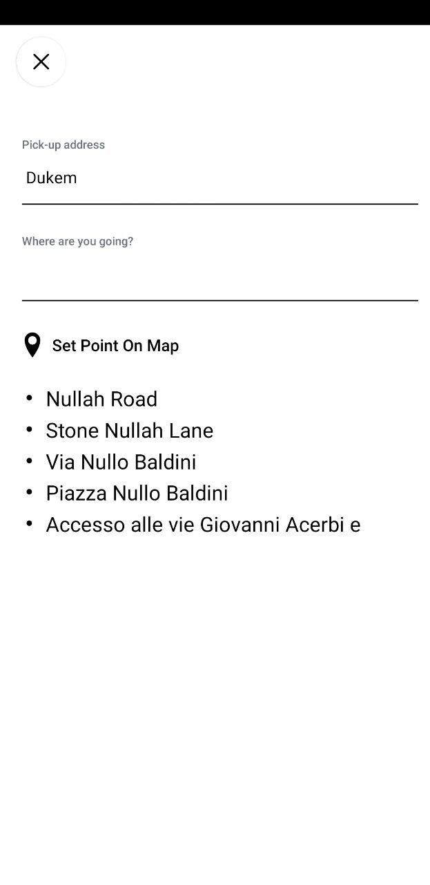
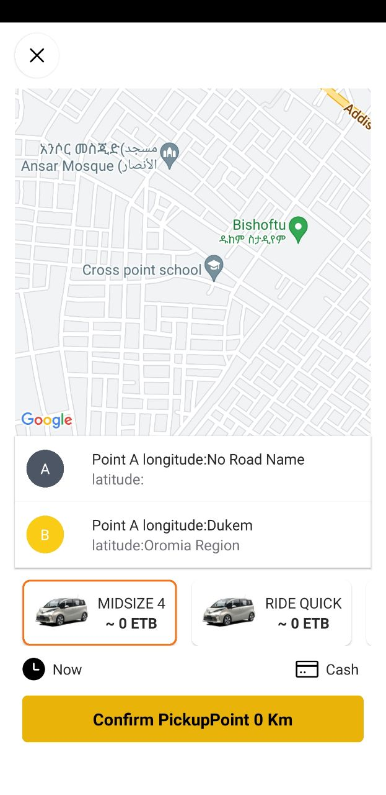
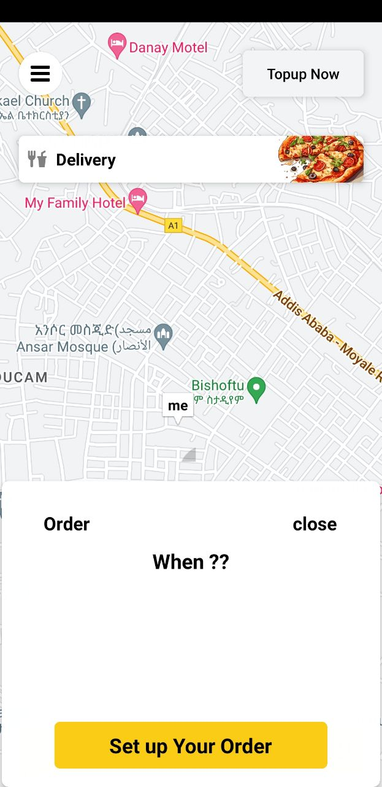

# RideShare App

A ride-sharing application prototype with a React Native client and a Node.js/Express backend. The backend uses MongoDB and Socket.IO for ride and location-related workflows.

## Screenshots

| Pickup | Confirm ride | Home |
|---|---|---|
|  |  |  |

## Technology

### Mobile application
- React Native
- Expo
- Redux Toolkit
- React Navigation
- Expo Location and React Native Maps
- Socket.IO client

### Backend
- Node.js
- Express
- MongoDB and Mongoose
- Socket.IO
- JSON Web Tokens

## Repository structure

- `app/`: Expo Router screens.
- `Components/`, `Context/`, and `hooks/`: client components and application logic.
- `rideshareServer/`: backend API, MongoDB models, routes, and Socket.IO server.

## Setup

### Mobile app

```bash
npm install
npx expo start
```

### Backend

```bash
cd rideshareServer
npm install
cp .env.example .env
```

Set the MongoDB URI, JWT secret, and notification provider credentials in `rideshareServer/.env`. Start the backend with Node.js using the entry point `index.js`.

## Current limitations

This is an in-progress prototype, not a production ride-hailing service. Authentication and authorization need a complete security review. In particular, user and ride routes, Socket.IO event ownership, driver matching, OTP throttling, and location validation must be hardened before real users or payments are involved. Some features described in earlier versions of this README may be incomplete.
